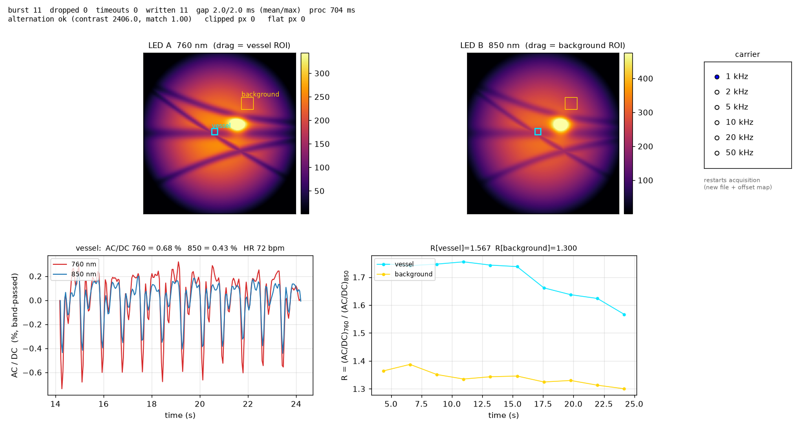
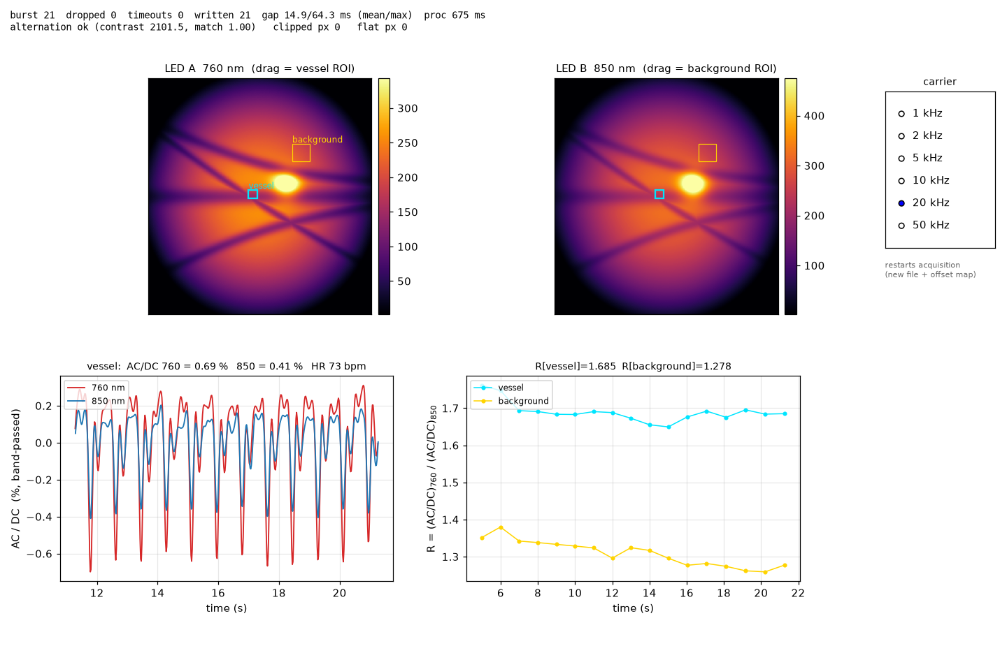

# c4_lockin_ppg: heliCam C4 two-LED real-time lock-in PPG

Streams lock-in frames from a **heliCam C4.2-S40U** (Heliotis) while two LEDs (~760 nm and
~850 nm) alternate frame by frame. It produces two live PPG traces (one per wavelength), the
ratio of ratios R, and raw HDF5 recordings for offline reprocessing.

The design is in [docs/design.md](docs/design.md); the camera manual is in
[docs/heliCamC4_UserManual-2025-08-28.pdf](docs/heliCamC4_UserManual-2025-08-28.pdf).

**Status:** the full pipeline runs against a simulated camera that checks feature names and
settings against ftrDesc v1.12.0. It has **not yet been run on the real camera**. Lines
marked `VERIFY` in the code need checking on the hardware. The LED controller firmware
is an untested draft.

## How it works (short)

* The camera is the only clock: internal 1 kHz reference, 20 demodulated plus 2 blank periods per frame
  (22 ms, ~45 fps), freerunning pipelined bursts of 100 frames.
* RTIO3 = `LockInReference` gates both LEDs through AND gates. RTIO2 = `LockInFrameSync` tells a small
  microcontroller to switch LEDs in the blank periods. `RecordingActive` resets it to LED A at each
  burst start. Even frames are therefore LED A (760 nm) and odd frames LED B (850 nm).
* Per burst: decode → offset correction (one I0/Q0 map per LED) → A/B check → amplitude √(I²+Q²) →
  ROI means → rolling 0.5–5 Hz band-pass → R = (AC/DC)₇₆₀ / (AC/DC)₈₅₀.
* Three threads (Acquirer, Processor, Writer) plus the matplotlib view on the main thread. A slow
  plot or disk never blocks `camera.fetch()`; if things back up, bursts are dropped and counted.

## Setup

```bat
cd "E:\A Project\c4_lockin_ppg"
E:\miniconda3\python.exe -m venv .venv
.venv\Scripts\python -m pip install -r requirements.txt
```

The camera driver is **C4Utility 1.12** (`C:\Program Files\C4Utility`). Its installer sets
`DIAPHUS_GENTL64_FILE`. If that variable is missing, the code falls back to
`C:\Program Files\C4Utility\diaphus\win64-x64\diaphus.cti`.

## Commands

Every command accepts `--sim` (simulated camera and LED controller), `--config my.yaml`, and
`--set key=value` (repeatable). `python -m c4ppg config` prints every setting.

| Command | What it does |
|---|---|
| `python -m c4ppg plan` | Real-time feasibility of the config (Heliotis C4 calculator): link load, frame/burst timing, PPG Nyquist, photon budget and allowed LED power, burst-size table. No camera needed |
| `python -m c4ppg plan --carrier 20k` | Same at another carrier |
| `python -m c4ppg check` | Build step 1: configure and print the read-back actual values with PASS/FAIL (reference ≈ 1000 Hz, 20 + 2 periods, ≈ 45 fps) |
| `python -m c4ppg beat [--plot]` | Build step 2: internal LED module 25 Hz off a 10 kHz reference; checks the 25 Hz beat in I/Q (like `c4DemodSimple.py`) |
| `python -m c4ppg live` | Records the offset map (controller in OFFSET mode), then live view + raw HDF5. Options: `--duration S`, `--bursts N`, `--no-view`, `--no-save`, `--no-offset` |
| `python -m c4ppg reprocess FILE.h5 [--set rois=...]` | Rebuilds traces and R from the raw data, with the same code as the live pipeline |

`run_live.bat` and `check_camera.bat` are double-click shortcuts. They pass their arguments on, so
`run_live.bat --sim` works.

Try it now without hardware:

```bat
.venv\Scripts\python -m c4ppg live --sim
```



**Live view:** drag on the 760 nm image to set the `vessel` ROI and on the 850 nm image to set the
`background` ROI. Press `1`–`9` to choose which ROI's traces are shown and `q` to quit. The status line
shows drops, gaps between bursts, clipped/flat pixel counts and the A/B alternation state.

**Each session writes** to `save_dir` (default `./data`):
* `c4ppg_<time>.h5`: raw I/Q bursts, offset maps, all config and actual camera values
* `_traces.csv` (ROI amplitude per frame and wavelength) and `_bursts.csv` (checks and R per burst)
* `_ppg.png` (summary plot), `_view.png` (last live view) and `.log`

## Carrier frequency

Default 1 kHz; choose another with `--carrier 20k` (any command), `ref_freq_hz` in the config, or the
**carrier selector in the live window**. Frame timing follows the carrier (20 ms integration / 22 ms
frame targets within the camera's 100 + 100 period limit) unless you pin `n_periods` / `n_blank`.
Switching in the window starts a new file and re-records the offset map. `python -m c4ppg plan` prints a
table of all preset carriers; continuous streaming works up to ~21.6 kHz, faster carriers need
`allow_link_limited: true` and short bursts (see [docs/design.md](docs/design.md) section 3b).



## Real-time feasibility

`python -m c4ppg plan` evaluates the config with the Heliotis C4 calculator (`c4ppg/feasibility.py`;
the tests reproduce every number in `C4_calculator_20240712_S4_S3.xlsx`). The key rule is that the
camera can stream back to back only if one frame takes at least 1.25 x 7.40 ms = 9.25 ms (link time
plus the spreadsheet's 25 % margin), i.e. <= 108 fps. The default 22 ms frames use 34 % of the link.
The burst length then only trades latency against RAM. `live` refuses settings that fail
(`--force` overrides) and the simulator uses the same link model for its transfer timing.

The photon budget shows how much light each LED may put on the sensor: at a 1 kHz carrier only about
0.24 mW (760 nm) over the whole array before 50 % full well in DC coupling. Set `led_power_mw` once
you have measured it.

## LED controller

[firmware/led_controller/led_controller.ino](firmware/led_controller/led_controller.ino) is a Teensy 4.x
sketch with the same state machine as `c4ppg/controller.py` (which the simulator runs edge by edge).
Set the link in the config: `controller: serial:COM7`. With `manual` (the default), the program
asks you to switch the controller mode by hand. The serial commands are R (run), O (offset),
A/B (one LED), X (off) and S\<n> (switch delay).

## Code map

```
c4ppg/
  feasibility.py Heliotis C4 calculator + streaming rules (`plan`)
  config.py      every tunable value (Config dataclass) + validation + YAML/--set overrides
  camera.py      C4Camera: configure(), read_actuals(), fetch_burst() on Harvesters
  sim.py         FakeHarvester: spec-checked node map + fundus phantom with known R
  controller.py  LED controller state machine + manual / serial / sim links
  processing.py  offset maps, amplitude, A/B alternation check, saturation counts
  ppg.py         rolling band-pass, AC/DC (with noise-floor correction), R, heart rate
  pipeline.py    Acquirer / Processor / Writer threads, gap detection, Session
  storage.py     HDF5 session writer/reader
  viewer.py      matplotlib live view (main thread)
  offline.py     CSV/PNG exports, reprocess
  cli.py         commands above
firmware/led_controller/   Teensy sketch (draft)
docs/          design.md, heliCam C4 user manual
tests/         pytest, all on the simulator
```

## Tests

```bat
.venv\Scripts\python -m pytest -q
```

The tests cover:
* configure and read-back, refusal of illegal settings, and the LineMode=Output requirement;
* burst decode, chunk timestamps and frame IDs, and the gap with and without pipelining;
* the controller state machine and A/B swap and broken-pattern detection;
* saturation counts and recovery of the phantom's known R (vessel within 8 %);
* live = offline reprocessing, dropping bursts instead of blocking, and the CLI.

## Notes and deviations from the first draft

* **LineMode:** ftrDesc 6.7 requires `LineMode = Output` before `LineSource`. `route()` sets it (needed for DIO lines).
* **Offset maps per LED:** LED A and LED B frames see different light, and the manual says the offset depends on total light. The offset map is therefore recorded per frame parity, with the controller alternating as in a run but at constant mean current.
* **write_q is 16 bursts, not 64:** one 100-frame burst is ~111 MB, so 64 would be ~7 GB of RAM.
* **Noise-floor correction:** in weakly pulsating regions, sensor noise inflates the AC at both wavelengths and pulls R towards 1. The white-noise power is measured at 6–10.5 Hz and subtracted (`noise_correct`). Use ROIs large enough for the pulsation you expect.
* **Per-frame timestamps:** these are derived from the burst's `ChunkTimestamp` plus the frame period until it is known how Harvesters exposes per-part chunks (open question in the design).

## Safety

Before any human retinal use, check the combined LED irradiance against the ocular exposure limits
(ANSI Z136 / ISO 15004-2) for both wavelengths.
